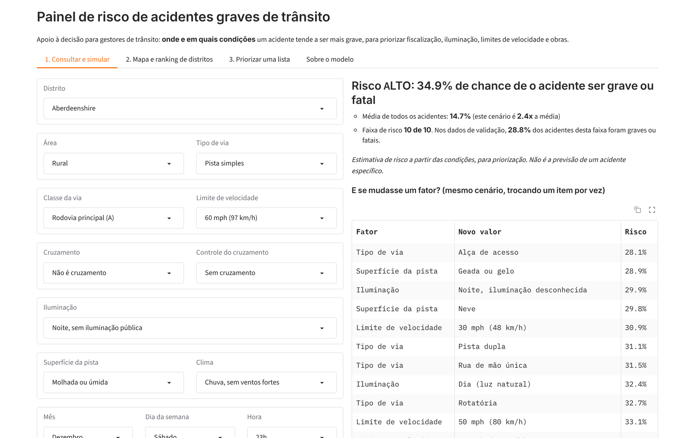
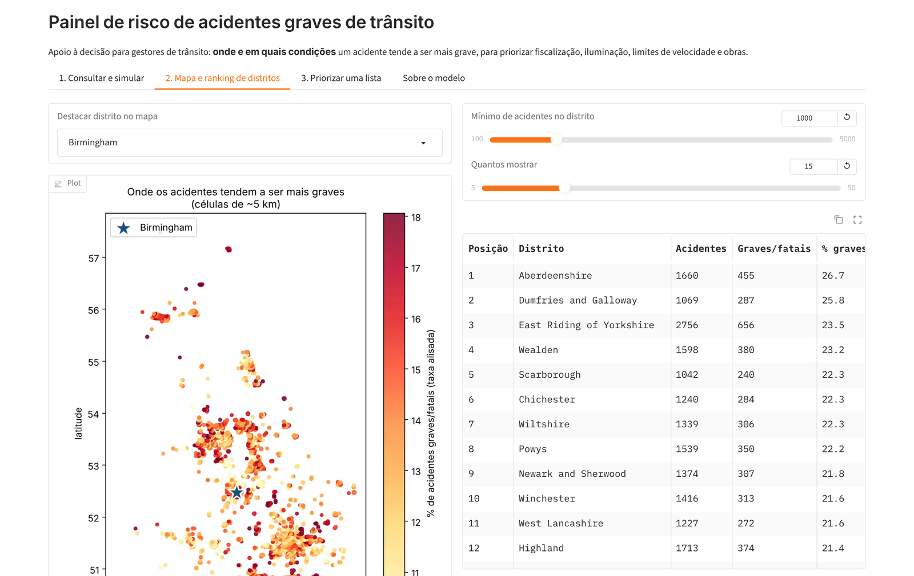
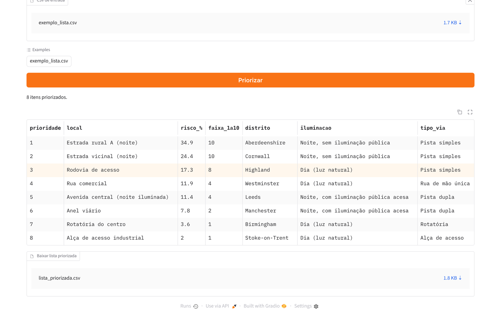
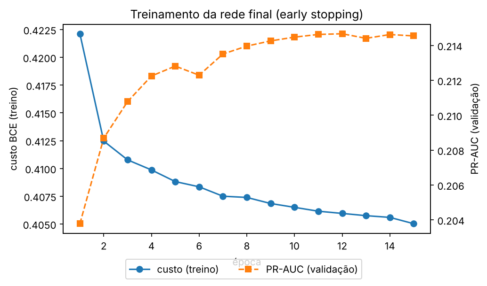
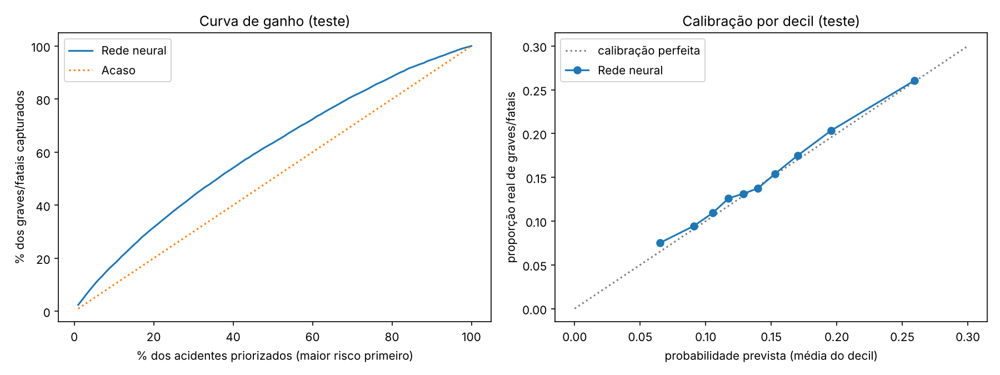

# Painel de risco de acidentes graves de trânsito (Reino Unido)

Trabalho 2 de Inteligência Artificial II (2026/02) · Faculdade Antonio Meneghetti (AMF) · Sistemas de Informação
Modalidade escolhida: **treinamento de rede neural**

**Integrantes:** Mell Campos, Brayan Martins e Nicolas Marin.



---

## 1. Problema

Gestores de trânsito têm verba limitada para fiscalização, iluminação e obras. A pergunta que o projeto responde é:

> Em quais condições e locais um acidente de trânsito tem maior chance de ser **grave ou fatal**?

O objetivo **não** é prever com certeza a gravidade de um acidente específico. É **priorizar risco**: ordenar situações da mais para a menos arriscada e mostrar quanto dos acidentes graves se concentra nas situações de maior risco estimado.

## 2. Solução

1. Uma **rede neural (PyTorch)** com embeddings que estima a probabilidade de um acidente ser grave ou fatal a partir das condições.
2. Uma análise de **pontos críticos (DBSCAN)** e do **risco por região**.
3. Um **painel em Gradio** (`app.py`) para o gestor, com três funções:
   - **Consultar e simular:** informa as condições e recebe o risco, a faixa (1 a 10) e uma tabela "e se mudasse um fator?", que mostra quanto o risco estimado muda trocando a iluminação, o tipo de via, a superfície, o clima ou a área.
   - **Mapa e ranking:** mapa de risco por células de ~5 km e ranking dos distritos com maior proporção de acidentes graves.
   - **Priorizar uma lista:** o usuário envia um CSV com vários locais/situações e recebe a lista ordenada por risco, pronta para baixar.

| Mapa e ranking | Priorização de lista |
|---|---|
|  |  |

## 3. Dados

- **Fonte:** dataset do Kaggle [`deeplumiere/accident-analysis-dataset`](https://www.kaggle.com/datasets/deeplumiere/accident-analysis-dataset) (~174 MB, 670.679 registros).
- **Colunas:** `Index`, `Accident_Severity`, `Accident Date`, `Latitude`, `Longitude`, `Light_Conditions`, `District Area`, `Number_of_Casualties`, `Number_of_Vehicles`, `Road_Surface_Conditions`, `Road_Type`, `Urban_or_Rural_Area`, `Weather_Conditions`, `Vehicle_Type`.

### Auditoria e limpeza

| Achado | Decisão |
|---|---|
| `Index` aparece como `2.01E+12` (notação científica) em 239.478 linhas, o que indica corrupção por planilha | `Index` descartado; cada linha é tratada como um registro |
| Nas 430.776 linhas com `Index` intacto, ele segue o padrão do STATS19 (dados oficiais do Reino Unido) e começa com o **ano real**: 2007, 2008, 2009 e 2010 aparecem como 2019, 2020, 2021 e 2022 | Os dados são de **2007 a 2010**, com o ano somado de 12. O **dia da semana** é calculado na data real (ver abaixo) |
| Exatamente 10.000 linhas com data de 2023 a 2025 (contra 144 a 182 mil por ano em 2019-2022) | Bloco excluído por suspeita de ter sido acrescentado ao dataset original |
| 52 linhas duplicadas e 26 sem coordenadas | Removidas |
| Nulos em clima, tipo de via, superfície e área | Categoria `Unknown` |

**Por que corrigir o dia da semana:** com a data do dataset, o pico de acidentes cai no sábado e o mínimo na segunda. Voltando 12 anos, o pico vai para a sexta e o mínimo para o domingo, que é o padrão conhecido do trânsito britânico. O mês não muda. A tabela que prova o deslocamento está no notebook (seção de auditoria).

**Base final: 660.601 registros.** Divisão estratificada 70/15/15 (`random_state=42`): 462.420 treino, 99.090 validação, 99.091 teste.

**Variável-alvo:** binária, `1` = acidente grave ou fatal (14,66% dos registros), `0` = leve. A distribuição original em três classes é 85,3% leve, 13,4% grave e 1,3% fatal.

**Variáveis de entrada** (14):

- 7 categóricas: iluminação, superfície da pista, tipo de via, área urbana/rural, clima, tipo de veículo e distrito (422 distritos + código para categoria desconhecida);
- 7 numéricas: latitude e longitude (padronizadas), mês e dia da semana (seno e cosseno) e indicador de fim de semana.

**Fora do modelo:** `Index`, `Number_of_Casualties` (a gravidade é definida pelas vítimas, então seria vazamento do alvo) e `Number_of_Vehicles` (só é conhecido depois do acidente; foi testado à parte, seção 6).

Vocabulários, médias e desvios são aprendidos **apenas no treino**, para não vazar informação da validação e do teste.

## 4. Abordagem

1. **Auditoria e limpeza** (seção anterior).
2. **Experimento inicial com 3 classes** (leve, grave, fatal). A classe fatal (1,3%) mostrou sinal muito fraco (PR-AUC de 0,03 para fatal), o que motivou o alvo binário.
3. **Baselines:** acaso, regressão logística e LightGBM.
4. **Rede neural** com embeddings e experimentos de função de custo e otimizador.
5. **Clusterização** (DBSCAN) e **risco por região**.
6. **Interpretação** (importância por permutação).
7. **Avaliação final no teste**, aberto uma única vez.
8. **Experimentos extras:** várias sementes, validação temporal e ablação com `Number_of_Vehicles`.
9. **Painel** em Gradio.

### Métricas

Acurácia não serve aqui: um modelo que sempre responde "leve" acerta 85,3% e é inútil. Usamos:

- **PR-AUC** (referência: 0,147, a proporção de positivos) e **ROC-AUC**;
- **captura no top k%**: que fração dos acidentes graves/fatais está entre os k% de maior risco estimado. Ao acaso, seria k%.

## 5. Arquitetura da rede neural

```
7 variáveis categóricas ──► Embedding (dim = min(16, (n+1)//2)) cada ──┐
                                                                         ├─► concatenação (50)
7 variáveis numéricas ───────────────────────────────────────────────────┘
        │
        ▼
Linear(50→128) · ReLU · Dropout(0,3) · Linear(128→64) · ReLU · Dropout(0,3) · Linear(64→1)  ──► logit
```

- 21.902 parâmetros.
- Adam (`lr=1e-3`), batch de 1.024, até 15 épocas, **early stopping** com paciência de 3, monitorado pelo PR-AUC na validação (os pesos da melhor época são restaurados).
- `BCEWithLogitsLoss` (a saída é um logit; a sigmoide só é aplicada na predição). Sementes fixas.



### Experimentos (validação)

| Rede | Função de custo / otimizador | PR-AUC | Probabilidade média prevista |
|---|---|---|---|
| 1 | BCE com `pos_weight` (5,82), Adam | 0,2150 | 0,483 |
| **2** | **BCE sem pesos, Adam** | **0,2157** | **0,148** |
| 3 | Focal loss (γ=2, α=0,75), Adam | 0,2151 | 0,432 |
| 4 | BCE sem pesos, SGD com momentum (lr 0,05) | 0,2111 | n/d |

Proporção real de graves/fatais: 0,1466. As diferenças de PR-AUC entre as redes 1, 2 e 3 são menores do que a variação entre sementes. O que muda é a **calibração**: peso de classe e focal loss superestimam a probabilidade (média ~0,43 a 0,48), e a Rede 2 acerta a média. Por isso a Rede 2 é o modelo final. O Adam chegou em 3 épocas ao patamar que o SGD (sem ajuste fino) levou 15 épocas para alcançar.

## 6. Resultados

### Avaliação final no conjunto de teste

| Modelo | PR-AUC | ROC-AUC | Captura top 10% | Captura top 20% | Captura top 30% |
|---|---|---|---|---|---|
| Acaso | 0,146 | 0,500 | 10,0% | 20,2% | 30,0% |
| Regressão logística | 0,214 | 0,615 | 18,0% | 31,6% | 43,6% |
| LightGBM | 0,211 | 0,609 | 17,6% | 31,3% | 42,9% |
| **Rede neural (Rede 2)** | **0,216** | **0,616** | **17,9%** | **31,5%** | **43,7%** |

- Os 10% de situações de maior risco estimado concentram **~18% dos acidentes graves e fatais**, quase o dobro do acaso; os 30% de maior risco concentram ~44%.
- **Rede x regressão logística:** com 5 sementes, a rede fica em PR-AUC 0,2153 ± 0,0005 contra 0,2142 da regressão. A diferença é consistente, mas pequena demais para ter importância prática (bootstrap pareado no teste: IC 95% de [-0,0001; 0,0030]). Modelos mais complexos não extraíram mais sinal que o modelo linear; a vantagem da rede é ser um único modelo bem calibrado que alimenta o painel.
- **Calibração:** em todos os 10 decis de risco, a probabilidade prevista acompanha a proporção real (de 7,1% previsto contra 7,5% real no decil mais baixo até 26,7% contra 26,3% no mais alto).



### Experimentos extras (`src/experimentos.py`)

Rede 2, 5 sementes, média ± desvio no teste ([detalhes](docs/resultados_experimentos.md)):

| Cenário | PR-AUC | ROC-AUC | Captura top 10% |
|---|---|---|---|
| Divisão aleatória, dia da semana original | 0,2155 ± 0,0012 | 0,6161 ± 0,0009 | 17,9% |
| Divisão aleatória, dia da semana corrigido | 0,2153 ± 0,0005 | 0,6159 ± 0,0007 | 17,9% |
| **Temporal: treino 2007-2009, teste 2010** | **0,2020 ± 0,0010** | **0,6051 ± 0,0008** | **17,6%** |
| Aleatória + `Number_of_Vehicles` | 0,2369 ± 0,0006 | 0,6539 ± 0,0005 | 19,3% |

- **Dia da semana:** a correção não muda as métricas (o calendário pesa pouco), mas deixa o modelo e o painel coerentes com o dia real.
- **Validação temporal:** treinando só com o passado e testando no ano seguinte, o ROC-AUC cai de 0,616 para 0,605 e a captura no top 10% quase não muda. O padrão aprendido **se sustenta no tempo**.
- **`Number_of_Vehicles`:** aumenta o ROC-AUC para 0,654, mas só é conhecido depois do acidente. Fica fora do painel de prevenção e é uma ideia para um uso diferente (triagem de ocorrências, seção 10).

### Pontos críticos e risco por região

**DBSCAN sobre os acidentes graves/fatais do treino** (distância haversine). Varremos `eps` ∈ {200, 500, 1000, 2000} m e `minPts` ∈ {10, 20, 50}, avaliando silhouette e Davies-Bouldin (só sobre pontos em clusters). As melhores métricas vinham de configurações que cobriam menos de 1% dos pontos, então escolhemos **`eps` = 2000 m e `minPts` = 50**: 90 clusters, 34,5% dos pontos em clusters, silhouette 0,513 e Davies-Bouldin 0,298.

**Os clusters marcam volume, não risco.** Na validação, 45,8% dos acidentes caem dentro dos clusters, mas a proporção de graves ali é **menor**:

| Validação | Graves/fatais |
|---|---|
| Global | 14,7% |
| Dentro dos clusters | 13,1% |
| Fora dos clusters | 16,0% |

Só 8,3% dos acidentes dentro dos clusters são rurais, contra 59,7% fora. Acidentes rurais têm proporção maior de graves (17,8% contra 12,9% nos urbanos).

**Risco por região** (células de ~5 km, taxa alisada): as regiões que parecem mais perigosas no treino continuam parecendo na validação.

| | Células | Spearman (treino × validação) | 20% de maior taxa no treino → validação | 20% de menor taxa → validação |
|---|---|---|---|---|
| Todas | 977 | 0,325 | 15,5% | 10,3% |
| Urbanas | 920 | 0,302 | 14,9% | 10,0% |
| Rurais | 337 | 0,373 | 18,5% | 9,2% |

O padrão regional persiste dentro de áreas urbanas e rurais, então não é só o efeito "rural contra urbano".


### O que o modelo usa (importância por permutação, validação)

| Bloco | Queda de PR-AUC |
|---|---|
| Localização (distrito, coordenadas, rural/urbano) | 0,0470 |
| Condições da via e do ambiente (luz, tipo de via, superfície, clima) | 0,0300 |
| Calendário (mês, dia da semana) | 0,0095 |
| Tipo de veículo | 0,0000 |

Na validação, a proporção de graves/fatais é de **23,1% sem iluminação pública contra 13,6% de dia**, e de **8,5% em rotatórias contra 15,6% em pistas simples**. O tipo de veículo não discrimina a gravidade neste dataset (motocicletas entre 14,0% e 15,2%, carros 14,6%), o que contraria estatísticas de trânsito em geral; por isso evitamos conclusões sobre veículos.

## 7. Estrutura do repositório

```
├── app.py                         # painel Gradio (usa o modelo salvo em modelos/)
├── notebooks/
│   └── Trabalho_IA_G2_Acidentes_no_Reino_Unido.ipynb   # análise completa, com as saídas
├── src/
│   ├── dados.py                   # carga, limpeza, correção de datas, features, divisões
│   ├── modelo.py                  # rede neural, treino com early stopping, métricas
│   ├── treinar.py                 # treina o modelo final e gera modelos/ e figuras/
│   └── experimentos.py            # sementes, validação temporal, ablação
├── modelos/                       # rede_final.pt + artefatos (vocabulários, faixas, mapa, ranking)
├── docs/
│   ├── resultados_experimentos.md # saída de src/experimentos.py
│   └── exemplo_lista.csv          # exemplo de entrada para a aba "Priorizar uma lista"
├── figuras/                       # gráficos e prints do painel
├── data/                          # coloque aqui o accident_data.csv (não versionado)
└── requirements.txt
```

## 8. Como executar

Requisitos: Python 3.10+ e ~2 GB livres. CPU é suficiente.

### Painel (sem precisar do dataset)

O modelo treinado já está em `modelos/`.

```bash
git clone https://github.com/mellcs/Trabalho-IA2.git
cd Trabalho-IA2
pip install -r requirements.txt
python app.py              # abre em http://127.0.0.1:7860
python app.py --share      # opcional: link público temporário
```

### Reproduzir o treino e os experimentos

1. Baixe o dataset em <https://www.kaggle.com/datasets/deeplumiere/accident-analysis-dataset> e salve como `data/accident_data.csv`.
2. Rode:

```bash
python -m src.treinar --csv data/accident_data.csv        # ~2 min: modelo final, modelos/ e figuras/
python -m src.experimentos --csv data/accident_data.csv   # ~20 min: docs/resultados_experimentos.md
```

### Notebook no Google Colab

1. Abra `notebooks/Trabalho_IA_G2_Acidentes_no_Reino_Unido.ipynb` no Colab (Arquivo → Abrir notebook → GitHub).
2. Envie o CSV ao Colab (painel de arquivos à esquerda) com o nome `accident_data.csv`.
3. **Ambiente de execução → Executar tudo.** A última célula instala o Gradio e abre a interface simples do notebook com link público.

O modelo do painel é treinado por `src/treinar.py` com a mesma arquitetura, divisão e sementes do notebook (métricas iguais até a terceira casa decimal).

Notas: sementes fixas (`random_state=42`, `torch.manual_seed(42)`); diferenças na quarta casa decimal podem aparecer conforme a versão das bibliotecas. Cada rede leva ~1 minuto em CPU. Se o Colab reiniciar a sessão e aparecer `NameError`, execute de novo desde o início.

## 9. Limitações

- **Sinal fraco.** ROC-AUC de ~0,62. O dataset não traz as variáveis que mais determinam a gravidade (velocidade, idade, uso de cinto). O projeto serve para **priorizar risco**, não para prever um acidente.
- **Associação, não causa.** A simulação "e se mudasse um fator?" mostra como o risco estimado muda, não garante o efeito de uma obra. Alguns resultados são contraintuitivos e conhecidos na literatura (pistas com gelo ou neve têm acidentes menos graves, provavelmente porque se dirige mais devagar).
- **Dados antigos e com problemas.** Os acidentes são de 2007 a 2010, o `Index` está corrompido em ~36% das linhas e o bloco 2023-2025 foi excluído. O comportamento do tipo de veículo é inesperado.
- **Localização aproximada.** O painel usa o centro dos acidentes do distrito, perdendo a variação dentro dele.
- **Calibração nos extremos.** Verificada por decil; probabilidades acima de ~30% vêm de combinações raras e são extrapolação.
- **Sem ajuste fino de hiperparâmetros.** A arquitetura e o LightGBM usaram valores fixos.

## 10. Impacto e próximos passos

- **Uso real:** órgãos de trânsito podem usar o painel para escolher onde instalar iluminação, reforçar fiscalização em noites de fim de semana em vias rurais, ou ordenar uma lista de trechos candidatos a obras.
- **Dados atuais:** treinar com os dados abertos oficiais do Reino Unido (STATS19, até o ano mais recente), que trazem também limite de velocidade e horário.
- **Triagem de ocorrências:** um segundo modelo com variáveis conhecidas logo após o acidente (como `Number_of_Vehicles`, que sobe o ROC-AUC para 0,65) poderia ajudar a priorizar o envio de ambulâncias.
- **Mapa interativo** com entrada por coordenadas, em vez do centro do distrito.
- **Incerteza por região**, para marcar células com poucos acidentes.
