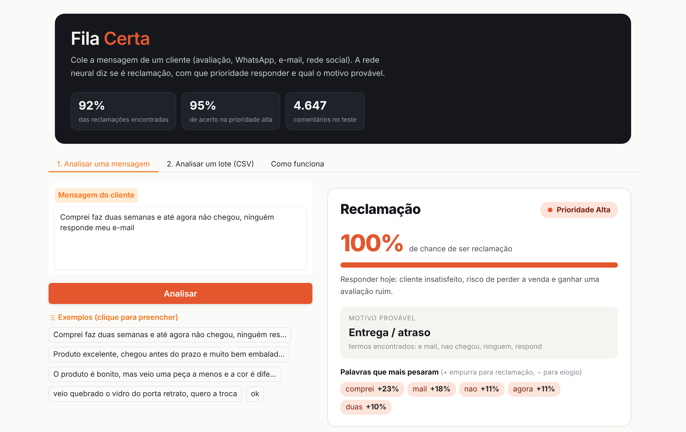
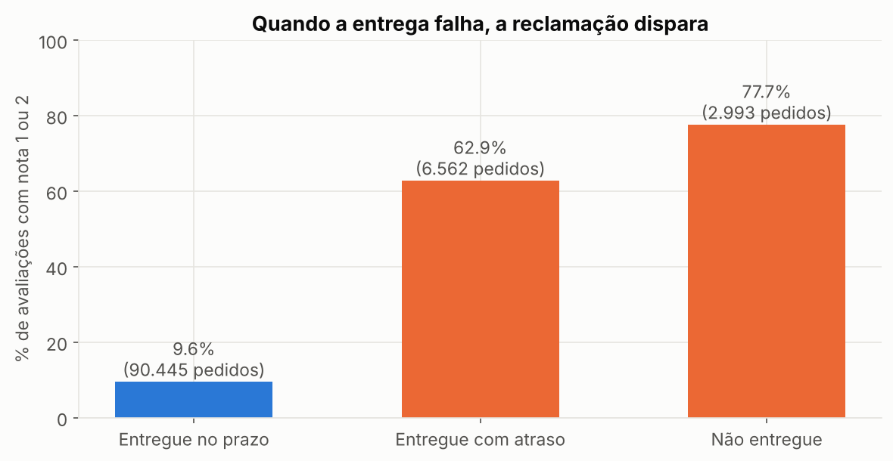
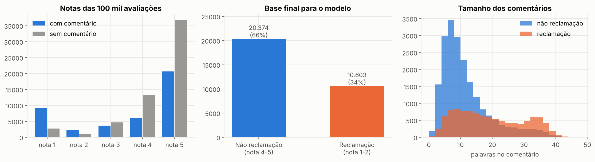
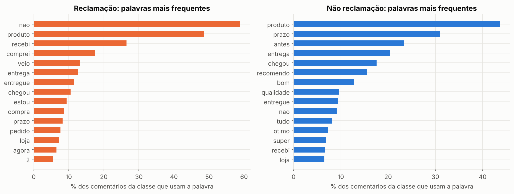
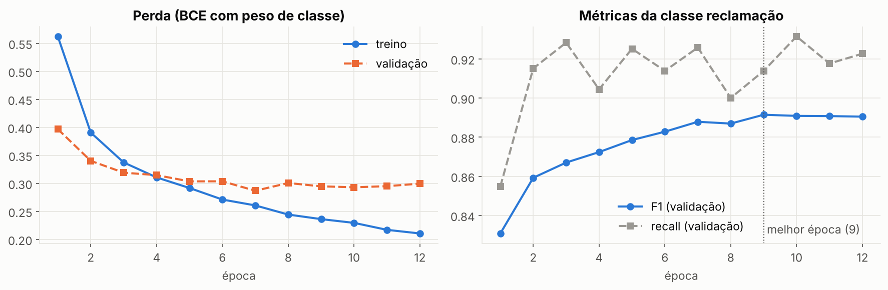
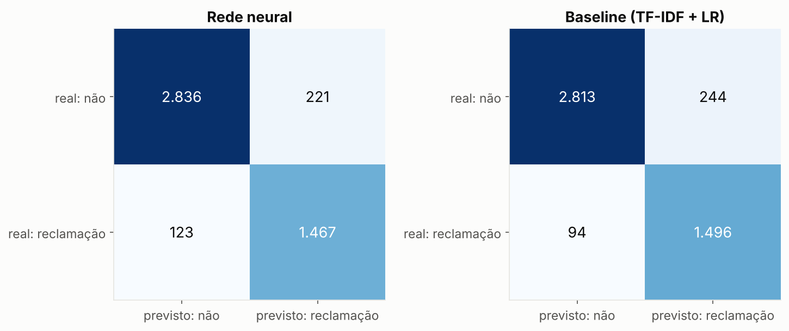
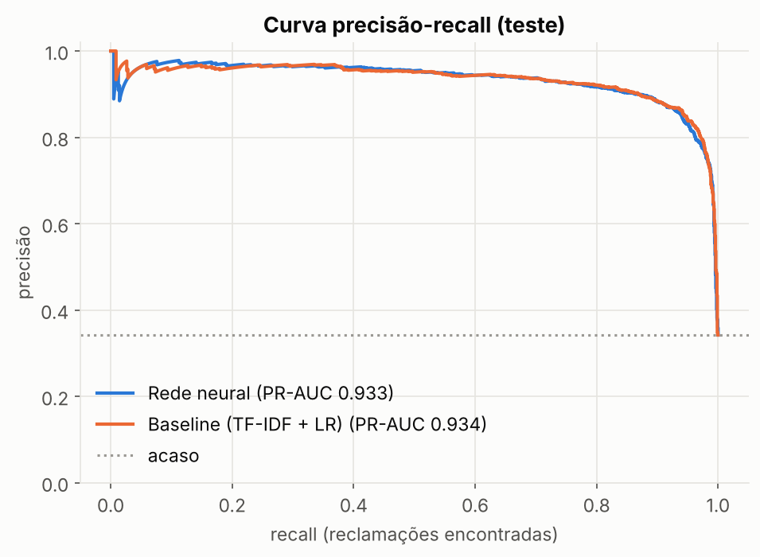
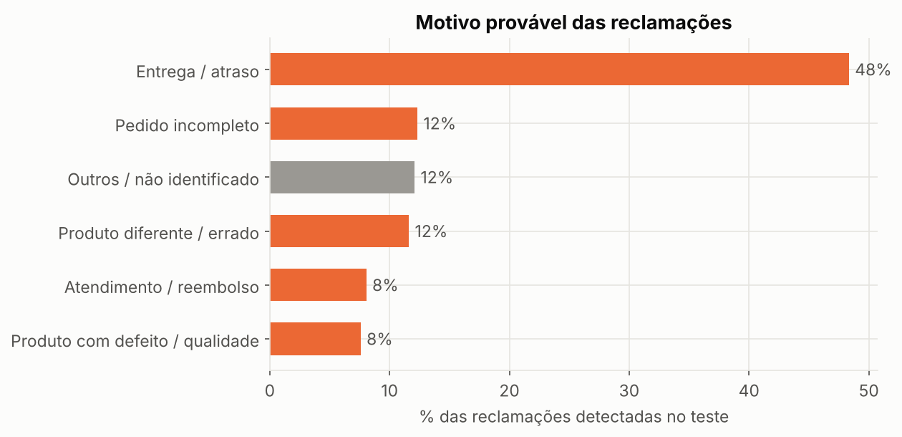
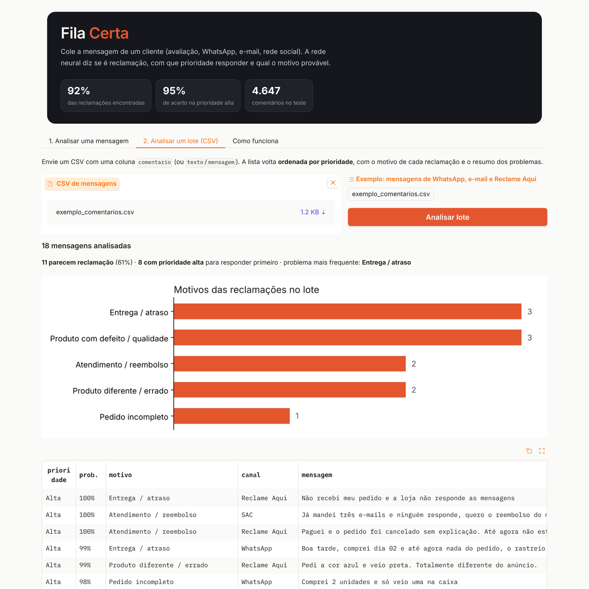

# Triagem de reclamações de clientes com rede neural

Trabalho 2 de Inteligência Artificial II (2026/02) · Faculdade Antonio Meneghetti (AMF) · Sistemas de Informação
Modalidade: **treinamento de rede neural** (PLN em português, PyTorch)

**Integrantes:** Mell Campos, Brayan Martins e Nicolas Marin.

> Começamos o trabalho com outro tema (gravidade de acidentes de trânsito no Reino Unido) e trocamos porque o melhor modelo ficou em ROC-AUC 0,63. O que foi feito e o motivo da troca estão em [HISTORICO_DO_PROJETO.md](HISTORICO_DO_PROJETO.md), e o código antigo está em [`tema1_acidentes/`](tema1_acidentes/).



---

## 1. O problema

Uma loja online com bom volume de vendas recebe dezenas ou centenas de mensagens por dia: avaliações, WhatsApp, e-mail, Instagram, Reclame Aqui. Ninguém consegue ler tudo na hora. O resultado:

- a reclamação do cliente cujo pedido **não chegou** fica no meio de centenas de "amei, recomendo";
- a resposta demora, o cliente não volta e ainda avalia mal a loja em público;
- o lojista não enxerga **qual problema se repete**, se é entrega, defeito ou produto errado.

**O tamanho do problema, com os dados da própria Olist** (100 mil pedidos reais, 2016-2018):

| Situação do pedido | Pedidos | Avaliações com nota 1 ou 2 |
|---|---|---|
| Entregue no prazo | 90.445 | **9,6%** |
| Entregue com atraso | 6.562 | **62,9%** |
| Não entregue | 2.993 | **77,7%** |

Quando a entrega falha, a chance de reclamação fica **6,6× maior**. São exatamente essas mensagens que precisam de resposta rápida.



## 2. A solução

Uma **rede neural treinada do zero** lê a mensagem do cliente em português e devolve, em menos de um segundo:

1. **se é reclamação**, com a probabilidade;
2. a **prioridade de atendimento** (alta, média ou baixa);
3. o **motivo provável**: entrega/atraso, defeito/qualidade, produto diferente, pedido incompleto, atendimento/reembolso;
4. **as palavras que mais pesaram** na decisão, para a equipe confiar (ou não) no resultado.

Num **lote** de mensagens (CSV), o app devolve a fila ordenada por prioridade e o resumo dos problemas mais frequentes.

**Valor gerado:**

| Para quem | Valor |
|---|---|
| Equipe de atendimento | Lê primeiro quem está insatisfeito. Na faixa **alta** (21% das mensagens), **95%** são reclamações de verdade. |
| Lojista | Vê qual problema se repete e corrige a causa (trocar de transportadora, revisar fornecedor ou anúncio). |
| Cliente | Recebe resposta mais rápida, o que reduz avaliação negativa pública e cliente perdido. |

Na faixa **baixa** (59% das mensagens) só 2,2% são reclamações. São mensagens que podem esperar ou receber uma resposta automática de agradecimento.

### Por que treinar com avaliações que já têm nota?

No Olist, quem escreve já deu uma nota, então classificar o texto parece redundante. **A nota é usada só como rótulo de treino** (proxy do sentimento): nota 1 ou 2 conta como reclamação, nota 4 ou 5 como não reclamação. O uso pensado é em mensagens que **chegam sem nota**: SAC, WhatsApp, e-mail, redes sociais e sites de reclamação. Por isso a demonstração inclui um lote de mensagens desses canais ([`docs/exemplo_comentarios.csv`](docs/exemplo_comentarios.csv)).

**Limitação:** o modelo aprendeu com avaliações de e-commerce. Antes de usar em outro canal é preciso validar com mensagens reais dele (seção 9).

## 3. Dados

**Brazilian E-Commerce Public Dataset by Olist** (Kaggle `olistbr/brazilian-ecommerce`). Usamos duas tabelas: avaliações (nota e comentário) e pedidos (status e datas de entrega).

| Etapa de limpeza | Linhas |
|---|---|
| Avaliações no arquivo | 100.000 |
| Com comentário em texto | 41.726 |
| Sem review_id repetido | 41.404 |
| Sem a nota 3 (neutra) | 37.770 |
| Sem textos com rótulos conflitantes | 34.446 |
| Sem textos duplicados (base final) | 30.977 |

- **Alvo `negativo`:** 1 se a nota for ≤ 2; 0 se for ≥ 4.
- **Base final:** 34,2% de reclamações.
- **Nota 3 fora:** num teste com três classes (TF-IDF + LR), a classe neutra ficou com F1 de **0,27** (negativo 0,78, positivo 0,89). A nota 3 mistura elogio e crítica, e o produto precisa separar o que é reclamação.
- **Duplicados fora antes da divisão:** textos como "ótimo" aparecem centenas de vezes. Sem remover, o mesmo texto cairia no treino e no teste (vazamento). Textos iguais com notas de lados opostos (ex.: "bom" com nota 1 e com nota 5) também foram descartados.
- **Divisão:** 70/15/15 estratificada: 21.683 treino, 4.647 validação, 4.647 teste. O teste foi usado **uma única vez**.




Reclamações são mais longas (mediana de 17 palavras contra 9). O cliente insatisfeito explica o problema, e o satisfeito escreve "ótimo".

## 4. Como a rede funciona

```
"não recebi meu pedido"
      │  normalizar: minúsculas, sem acento → "nao recebi meu pedido"
      ▼
[ 3583, 4533, 3459, 3923, 0, 0, ... ]   índices do vocabulário (5.585 palavras, até 60 tokens)
      │
      ▼  Embedding (100 dimensões)        cada palavra vira um vetor aprendido
      ▼  BiLSTM (64 por direção)          lê a frase nos dois sentidos, guardando o contexto
      ▼  pooling: máximo ‖ média          resume a frase num vetor de tamanho fixo (256)
      ▼  Dropout 0,4 → Linear → sigmoide
   P(reclamação) = 1,00 ──► prioridade ALTA ──► motivo: Entrega / atraso
```

| Decisão | Por quê |
|---|---|
| Tirar acentos, manter "não" | Clientes escrevem "nao", "não" e "NÃO", e as três formas viram o mesmo token. A negação muda o sentido, então não usamos lista de stopwords. |
| Vocabulário só do treino, mínimo de 2 ocorrências | Evita vazamento. Palavras raras viram `<UNK>`. |
| Embedding aprendido do zero | Requisito do trabalho (modelo próprio). Palavras usadas em contextos parecidos ficam próximas ("péssimo" e "horrível"). |
| BiLSTM | Lê a sequência em ordem: "não chegou" ≠ "chegou". Bidirecional para cada palavra ver o que vem antes e depois. |
| Pooling máximo + média | O máximo pega o trecho mais forte ("veio quebrado"); a média, o tom geral. |
| BCE com `pos_weight` ≈ 1,9 | Reclamações são 1/3 da base. Sem o peso, a rede tende a errar mais justamente na classe que interessa. |
| Adam (lr 1e-3), lote 128, *gradient clipping* | Padrão estável para LSTM. |
| *Early stopping* pelo F1 da validação (paciência 3) | Para quando a validação para de melhorar e guarda a melhor época (evita overfitting). |
| Métrica principal: F1 e recall da classe reclamação | É a classe que o negócio quer encontrar. Acurácia engana em base desbalanceada. |

Também treinamos uma **CNN 1D** (filtros de 2, 3 e 4 palavras). A arquitetura final foi escolhida pelo F1 médio na **validação** (BiLSTM 0,893, CNN 1D 0,889): **BiLSTM**. Total de **643.749 parâmetros**.



## 5. Resultados (conjunto de teste, 4.647 comentários)

| Modelo | F1 (reclamação) | Recall | Precisão | Acurácia | PR-AUC |
|---|---|---|---|---|---|
| **Rede BiLSTM** (escolhida) | 0,897 ± 0,001 | 0,927 ± 0,004 | 0,868 ± 0,002 | 0,927 ± 0,001 | 0,936 ± 0,003 |
| Rede CNN 1D | 0,895 ± 0,003 | 0,931 ± 0,004 | 0,862 ± 0,008 | 0,925 ± 0,002 | 0,934 ± 0,005 |
| Baseline (TF-IDF + LR) | 0,898 | 0,941 | 0,860 | 0,927 | 0,934 |

Redes: média ± desvio de 3 sementes. Limiar 0,5.

**Leitura honesta: a rede empata com o baseline.** É um resultado esperado, e explicamos por quê:

- os comentários são **curtos** (mediana de 11 palavras), e expressões como "não recebi" e "veio quebrado" já aparecem como **bigramas** no TF-IDF;
- com cerca de 22 mil exemplos, a rede aprende os embeddings do zero, sem conhecimento prévio da língua;
- muitos erros vêm do **rótulo**, não do texto: o cliente elogia e dá nota 1, ou reclama e dá nota 5 (seção 6).

Mesmo empatando, a rede acerta onde o baseline erra em **79** comentários, e o contrário acontece em 85. Ela é a base para as próximas etapas: transferência para outros canais, motivo aprendido e três classes.




### Prioridade de atendimento

Limiares definidos na **validação**: alta = a partir de onde pelo menos 95% são reclamações (p ≥ 0,97); baixa = abaixo de onde no máximo 2% são (p < 0,18). No teste:

| Prioridade | % das mensagens | % que são reclamação | % de todas as reclamações |
|---|---|---|---|
| Alta | 20,6% | 94,7% | 56,9% |
| Média | 20,5% | 65,6% | 39,3% |
| Baixa | 58,9% | 2,2% | 3,8% |

**Na prática:** respondendo primeiro a faixa alta, a equipe lê 21% das mensagens e já encontra **57% de todas as reclamações**, com quase nenhum alarme falso.

## 6. Análise de erros

Exemplos completos em [`results/erros.md`](results/erros.md). Padrões:

- **Falsos positivos:** o cliente relata um problema, mas dá nota alta porque foi resolvido ("atrasou um pouco, mas chegou certinho").
- **Falsos negativos:** texto neutro ou positivo com nota 1 ou 2. A nota reflete algo que o texto não diz (frete, demora na resposta) ou o cliente marcou a nota errada.
- Boa parte dos "erros" mais confiantes são **contradições entre texto e nota**. Exemplo: "Não foi entregue o meu pedido", com nota 5, conta como falso positivo, mas a rede está certa. É uma limitação do proxy, não da leitura do modelo.
- **Erro real em frase mista:** "Chegou rápido, mas parou de funcionar no segundo dia" sai com 0,3%. "Chegou rápido" é um dos sinais mais fortes de elogio nos dados e pesa mais que o defeito. Frases com "mas" são um ponto a melhorar (mais dados ou um modelo pré-treinado).
- **Onde a rede ganha:** "Pelo valor dele eu esperava um produto melhor." (nota 2) não tem palavra negativa óbvia. A rede dá 81% de reclamação, e o TF-IDF fica em 47%.

## 7. Motivo das reclamações (diferencial)

Não existe rótulo de motivo no dataset, então usamos **regras de palavras-chave** sobre o texto normalizado ([`src/motivos.py`](src/motivos.py)). São transparentes, porque o app mostra os termos encontrados, e fáceis de ajustar.

**Conferência com um dado independente:** o texto não sabe se o pedido atrasou, mas a tabela de pedidos sabe. Entre as reclamações detectadas no teste:

| Motivo | % das reclamações | Pedido atrasado ou não entregue |
|---|---|---|
| Entrega / atraso | 48,3% | 58,8% |
| Pedido incompleto | 12,3% | 12,0% |
| Outros / não identificado | 12,1% | 20,6% |
| Produto diferente / errado | 11,6% | 5,1% |
| Atendimento / reembolso | 8,1% | 50,0% |
| Produto com defeito / qualidade | 7,6% | 4,7% |

Nas reclamações classificadas como **Entrega / atraso**, 59% dos pedidos de fato atrasaram ou não foram entregues, contra 17% nos outros motivos. Isso mostra que a regra captura um problema real.



## 8. Como executar

**Pré-requisito:** Python 3.10 a 3.12. No Windows, use `py -3.12` no lugar de `python`.

```bash
git clone https://github.com/mellcs/Trabalho-IA2.git
cd Trabalho-IA2
pip install -r requirements.txt

# só o app (usa o modelo já treinado em models/)
python app.py                     # abre http://127.0.0.1:7860

# reproduzir tudo do zero
python -m src.baixar_dados        # baixa os CSVs da Olist para data/ (sem login)
python -m src.treinar             # ~15 min em CPU; regrava models/ e results/
```

**Google Colab:** abra [`notebooks/Trabalho2_IA2_Triagem_Reclamacoes.ipynb`](notebooks/Trabalho2_IA2_Triagem_Reclamacoes.ipynb). Ele clona o repositório, baixa os dados e roda tudo do começo ao fim.

| Pasta | Conteúdo |
|---|---|
| `src/` | `dados.py` (limpeza e divisão), `texto.py` (tokenização e vocabulário), `modelo.py` (BiLSTM, CNN e treino), `motivos.py`, `inferencia.py`, `treinar.py` (pipeline completo), `baixar_dados.py` |
| `app.py` | App Gradio: um comentário, lote CSV e "como funciona" |
| `models/` | `rede.pt`, `vocab.json`, `config.json`, `baseline.joblib` |
| `results/` | gráficos, `metricas.json`, `resultados.md`, `erros.md`, `motivos.md`, prints do app |
| `notebooks/` | notebook Colab ponta a ponta |
| `docs/` | CSV de exemplo para o app, apresentação do pitch (HTML: abra no navegador, tecla F para tela cheia) e roteiro |
| `tema1_acidentes/` | primeiro tema (acidentes no Reino Unido), mantido como histórico |



## 9. Limitações

- **Proxy:** a nota não é uma anotação manual do sentimento. Há contradições entre texto e nota.
- **Domínio:** o modelo foi treinado em e-commerce (2016-2018). Mensagens de WhatsApp ou redes sociais têm gírias, emojis e abreviações diferentes. É preciso validar antes do uso real.
- **Viés de amostra:** só 42% das avaliações têm comentário.
- **Motivos por regra:** frases sem os termos-chave caem em "Outros" (12%), e uma reclamação com dois motivos recebe só o principal.
- **Sem a nota 3:** mensagens neutras e mistas são forçadas para um dos lados.

## 10. Próximos passos

1. **Validar em outro canal:** anotar cerca de 500 mensagens reais de SAC ou WhatsApp de um lojista e medir F1 ali.
2. **Modelo pré-treinado em português** (ex.: BERTimbau) para comparar com a rede do zero.
3. **Motivo aprendido:** rotular uma amostra de reclamações por motivo e treinar um classificador multirrótulo no lugar das regras.
4. **Integração:** ler a caixa de entrada (e-mail, WhatsApp Business API) e devolver a fila priorizada no sistema do lojista.
5. **Três classes**, com um conjunto de neutros anotado à mão.
