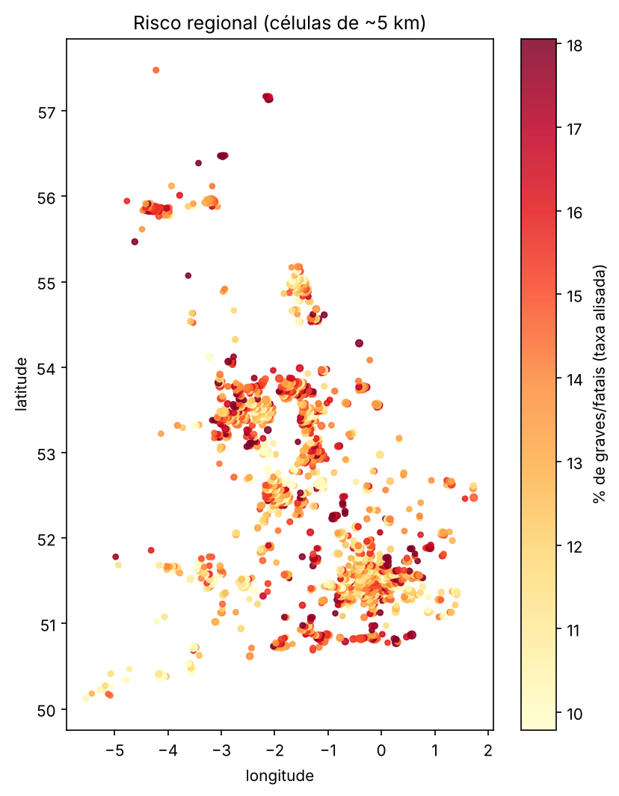

# Risco de acidentes graves de trânsito no Reino Unido

Trabalho 2 de Inteligência Artificial II (2026/02) · Faculdade Antonio Meneghetti (AMF) · Sistemas de Informação
Modalidade escolhida: **treinamento de rede neural**

**Integrantes:** Mell Campos, Brayan Martins e Nicolas Marin.

---

## 1. Problema

Gestores de trânsito têm recursos limitados para fiscalização e obras. A pergunta que este projeto responde é:

> Em quais condições e locais um acidente de trânsito tem maior chance de ser **grave ou fatal**?

O objetivo **não** é prever com certeza a gravidade de um acidente específico. É **priorizar risco**: ordenar situações da mais para a menos arriscada e medir quanto dos acidentes graves se concentra nas situações de maior risco estimado.

Entregas do projeto:

1. uma rede neural (PyTorch) que estima a probabilidade de um acidente ser grave ou fatal a partir das condições do acidente;
2. uma análise de pontos críticos (DBSCAN) e do risco por região;
3. uma interface (Gradio) para consultar o risco estimado.

## 2. Dados

- **Fonte:** dataset do Kaggle [`deeplumiere/accident-analysis-dataset`](https://www.kaggle.com/datasets/deeplumiere/accident-analysis-dataset) (~174 MB, 670.679 registros).
- **Origem geográfica:** coordenadas entre 49,9° e 60,8° de latitude e entre -7,5° e 1,8° de longitude, ou seja, Grã-Bretanha. O formato das colunas lembra os dados abertos de acidentes do Reino Unido, mas não conseguimos confirmar a procedência do dataset.
- **Colunas originais:** `Index`, `Accident_Severity`, `Accident Date`, `Latitude`, `Longitude`, `Light_Conditions`, `District Area`, `Number_of_Casualties`, `Number_of_Vehicles`, `Road_Surface_Conditions`, `Road_Type`, `Urban_or_Rural_Area`, `Weather_Conditions`, `Vehicle_Type`.

### Auditoria e limpeza

Antes de modelar, os dados foram auditados. O que encontramos e o que fizemos:

| Achado | Decisão |
|---|---|
| `Index` aparece como `2.01E+12` (notação científica) em 239.478 linhas, o que sugere corrupção por planilha | `Index` descartado; cada linha é tratada como um registro |
| Exatamente 10.000 linhas com data de 2023 a 2025 (contra ~95 a 116 mil por ano em 2019-2022), sem nenhuma delas no grupo de `Index` corrompido | Bloco excluído por suspeita de ter sido acrescentado ao dataset original (hipótese, não comprovada) |
| 52 linhas duplicadas | Removidas |
| 26 linhas sem coordenadas | Removidas |
| Nulos em clima, tipo de via, superfície e área | Categoria `Unknown` |

**Base final: 660.601 registros (2019-2022).** Divisão estratificada 70/15/15 (`random_state=42`): 462.420 treino, 99.090 validação, 99.091 teste.

**Variável-alvo:** binária, `1` = acidente grave ou fatal (14,66% dos registros), `0` = leve. A distribuição original em três classes é 85,3% leve, 13,4% grave e 1,3% fatal.

**Variáveis de entrada** (14 no total):

- 7 categóricas: iluminação, superfície da pista, tipo de via, área urbana/rural, clima, tipo de veículo e distrito (423 códigos, incluindo o código reservado para categorias desconhecidas);
- 7 numéricas: latitude e longitude (normalizadas), mês e dia da semana (codificados com seno e cosseno), e indicador de fim de semana.

**Fora do modelo:** `Index`, `Number_of_Casualties` (a gravidade é definida pelas vítimas, então seria vazamento do alvo) e `Number_of_Vehicles`.

Vocabulários, médias e desvios são aprendidos **apenas no treino**, para não vazar informação da validação e do teste.

## 3. Abordagem

O notebook segue esta sequência (todo o código está em um único arquivo):

1. **Auditoria e limpeza** dos dados (seção anterior).
2. **Experimento inicial com 3 classes** (leve, grave, fatal). A classe fatal (1,3%) mostrou sinal muito fraco: a regressão logística com `class_weight="balanced"` teve F1 macro de 0,300 (abaixo do baseline trivial, 0,307) e precisão de 2,6% para fatal. Isso motivou a mudança para o alvo binário.
3. **Alvo binário** e **baselines**: acaso, regressão logística e LightGBM.
4. **Rede neural** com embeddings, e experimentos controlados de função de custo e otimizador.
5. **Clusterização** (DBSCAN) e **risco por região**.
6. **Interpretação** do modelo (importância por permutação).
7. **Avaliação final no teste**, aberta uma única vez, e figuras.
8. **Interface** em Gradio.

### Métricas

Acurácia não serve neste problema: um modelo que sempre responde "leve" acerta 85,3% e é inútil. Usamos:

- **PR-AUC** (referência: 0,147, a proporção de casos positivos) e **ROC-AUC**;
- **captura no top k%**: que fração dos acidentes graves/fatais está entre os k% de maior risco estimado. Ao acaso, seria k%.

## 4. Arquitetura da rede neural

```
7 variáveis categóricas ──► Embedding (dim = min(16, (n+1)//2)) cada ──┐
                                                                         ├─► concatenação (50)
7 variáveis numéricas ───────────────────────────────────────────────────┘
        │
        ▼
Linear(50→128) · ReLU · Dropout(0,3) · Linear(128→64) · ReLU · Dropout(0,3) · Linear(64→1)  ──► logit
```

- 21.902 parâmetros.
- Treino: Adam (`lr=1e-3`), batch de 1.024, até 15 épocas, **early stopping** com paciência de 3 épocas, monitorado pelo PR-AUC na validação (os pesos da melhor época são restaurados).
- Sementes fixas (`torch.manual_seed(42)`), então os resultados são reproduzíveis.
- Função de custo: `BCEWithLogitsLoss` (a saída é um logit; a sigmoide só é aplicada na predição).

### Experimentos (validação)

| Rede | Função de custo / otimizador | PR-AUC | Probabilidade média prevista |
|---|---|---|---|
| 1 | BCE com `pos_weight` (5,82), Adam | 0,2150 | 0,485 |
| **2** | **BCE sem pesos, Adam** | **0,2159** | **0,148** |
| 3 | Focal loss (γ=2, α=0,75), Adam | 0,2146 | 0,433 |
| 4 | BCE sem pesos, SGD com momentum (lr 0,05) | 0,2101 | n/d |

Proporção real de graves/fatais: 0,1466. As diferenças de PR-AUC entre as redes 1, 2 e 3 (0,001) são menores do que a variação esperada entre sementes. O que muda de fato é a **calibração**: as redes treinadas com peso de classe ou focal loss superestimam a probabilidade (média ~0,43 a 0,49), enquanto a Rede 2 acerta a média. Por isso a Rede 2 é o modelo final e o usado na interface. O Adam atingiu em 3 épocas o patamar que o SGD (sem ajuste fino) levou 15 épocas para alcançar.

## 5. Resultados

### Avaliação final no conjunto de teste

| Modelo | PR-AUC | ROC-AUC | Captura top 10% | Captura top 20% | Captura top 30% |
|---|---|---|---|---|---|
| Acaso | 0,146 | 0,500 | 10,0% | 20,2% | 30,0% |
| Regressão logística | 0,214 | 0,615 | 17,9% | 31,4% | 43,6% |
| LightGBM | 0,212 | 0,608 | 17,6% | 31,0% | 42,7% |
| **Rede neural (Rede 2)** | **0,216** | **0,616** | **18,0%** | **31,6%** | **43,5%** |

- Os 10% de situações de maior risco estimado concentram **18% dos acidentes graves e fatais**, quase o dobro do acaso.
- A rede é **marginalmente melhor** que a regressão logística: diferença de PR-AUC de ~0,002, com intervalo de confiança de 95% (bootstrap pareado) de [0,0003; 0,0031]. A diferença é pequena demais para ter importância prática. Modelos mais complexos (LightGBM, rede) não extraíram mais sinal que o modelo linear.
- **Calibração:** em todos os 10 decis de risco, a probabilidade prevista acompanha a proporção real (de 7,2% previsto contra 7,6% real no decil mais baixo, até 26,4% contra 26,4% no mais alto).


### Pontos críticos e risco por região

**DBSCAN sobre os acidentes graves/fatais do treino** (distância haversine). Varremos `eps` ∈ {200, 500, 1000, 2000} m e `minPts` ∈ {10, 20, 50}, avaliando com silhouette e Davies-Bouldin (calculados só sobre os pontos dentro de clusters, silhouette em amostra de 10 mil pontos). As melhores métricas vinham de configurações que cobriam menos de 1% dos pontos, então escolhemos **`eps` = 2000 m e `minPts` = 50**: 90 clusters, 34,5% dos pontos em clusters, silhouette 0,513 e Davies-Bouldin 0,298.

**Os clusters marcam volume, não risco.** Na validação, 45,8% dos acidentes caem dentro dos clusters, mas a proporção de graves ali é **menor**:

| Validação | Graves/fatais |
|---|---|
| Global | 14,7% |
| Dentro dos clusters | 13,1% |
| Fora dos clusters | 16,0% |

Só 8,3% dos acidentes dentro dos clusters são rurais, contra 59,7% fora. Acidentes rurais têm proporção maior de graves (17,8% contra 12,9% nos urbanos).

**Risco por região** (células de ~5 km, taxa alisada para células pequenas): as regiões que parecem mais perigosas no treino continuam parecendo na validação.

| | Células | Spearman (treino × validação) | 20% de maior taxa no treino → validação | 20% de menor taxa → validação |
|---|---|---|---|---|
| Todas | 977 | 0,325 | 15,5% | 10,3% |
| Urbanas | 920 | 0,302 | 14,9% | 10,0% |
| Rurais | 337 | 0,373 | 18,5% | 9,2% |

O padrão regional persiste dentro de áreas urbanas e rurais, então não é apenas o efeito de "rural contra urbano". É uma associação estável, e o dataset não permite dizer por quê.



*Cada ponto é uma célula de ~5 km (tamanho proporcional ao número de acidentes, cor pela taxa alisada de graves/fatais). Pontos isolados com poucos acidentes ainda são ruidosos.*

### O que o modelo usa (importância por permutação, validação)

Queda do PR-AUC ao embaralhar cada bloco de variáveis (Rede 2, referência 0,2159):

| Bloco | Queda de PR-AUC |
|---|---|
| Localização (distrito, coordenadas, rural/urbano) | 0,0472 |
| Condições da via e do ambiente (luz, tipo de via, superfície, clima) | 0,0305 |
| Calendário (mês, dia da semana) | 0,0088 |
| Tipo de veículo | 0,0001 |

Na validação, a proporção de acidentes graves/fatais é de **23,1% sem iluminação contra 13,6% de dia**, e de **8,5% em rotatórias contra 15,6% em pistas simples**.

O tipo de veículo não discrimina a gravidade neste dataset (motocicletas ficam entre 14,0% e 15,2%, e carros em 14,6%). Isso contraria o esperado em estatísticas de trânsito em geral, e não conseguimos explicar a causa, então evitamos qualquer conclusão sobre veículos.

## 6. Interface

Uma tela em Gradio (executada dentro do notebook) onde se escolhem distrito, iluminação, tipo de via, área, superfície da pista, clima, mês e dia da semana. A resposta traz:

- a probabilidade estimada de o acidente ser grave ou fatal;
- a média geral (14,7%);
- a faixa de risco (decil 1 a 10) e a taxa real de graves naquela faixa na validação.

Decisões de projeto: a localização é o **centro dos acidentes do distrito escolhido** (o modelo usa coordenadas, e o usuário não precisa digitá-las), e o tipo de veículo é fixado em "carro", já que o modelo não o utiliza.


## 7. Limitações

- **Sinal fraco.** ROC-AUC de ~0,62. O dataset não traz as variáveis que mais determinam a gravidade (velocidade, idade dos envolvidos, uso de cinto). O projeto serve para **priorizar risco**, não para prever um acidente.
- **Associação, não causa.** Distrito, iluminação e tipo de via estão associados a mais ou menos acidentes graves. Os dados não dizem por quê.
- **Qualidade dos dados.** O `Index` está corrompido em ~36% das linhas, e o bloco de 2023-2025 foi excluído por suspeita. Não confirmamos a procedência do dataset, e o comportamento do tipo de veículo é inesperado.
- **Calibração nos extremos.** Foi verificada por decil, e o decil mais alto tem média de 26,4%. Combinações muito extremas (probabilidades de 30% ou mais) são raras nos dados, e o valor ali é uma extrapolação do modelo.
- **Localização aproximada.** A interface usa o centro do distrito, perdendo a variação dentro dele.
- **Uma semente e sem ajuste de hiperparâmetros.** A rede e o LightGBM foram treinados com uma única semente e hiperparâmetros fixos. Diferenças de milésimos entre modelos não são conclusivas.
- **Período.** Dados de 2019 a 2022.

## 8. Como executar

Requisitos: conta no Google (Colab gratuito, CPU é suficiente) e acesso ao Kaggle para baixar o dataset.

1. Baixe o dataset em <https://www.kaggle.com/datasets/deeplumiere/accident-analysis-dataset>.
2. Abra `Trabalho_IA_G2_Acidentes_no_Reino_Unido.ipynb` no Google Colab (Arquivo → Abrir notebook → GitHub).
3. Envie o CSV ao Colab (painel de arquivos à esquerda) com o nome `accident_data.csv`, ou ajuste a variável `csv` na primeira célula para o caminho do seu arquivo.
4. Execute tudo: **Ambiente de execução → Executar tudo**. A primeira célula de interface instala o Gradio com `!pip install -q gradio`.

Notas:

- Dependências principais: `pandas`, `numpy`, `scikit-learn`, `scipy`, `lightgbm`, `torch`, `matplotlib` e `gradio` (já vêm instaladas no Colab, exceto o Gradio). Fora do Colab, instale com `pip install pandas numpy scikit-learn scipy lightgbm torch matplotlib gradio`.
- Cada rede leva cerca de 3 a 4 minutos para treinar na CPU do Colab.
- Todas as sementes estão fixas (`random_state=42` e `torch.manual_seed(42)`), então os números devem se repetir. Pequenas diferenças na quarta casa decimal podem aparecer conforme a versão das bibliotecas.
- O Colab pode reiniciar a sessão e apagar as variáveis. Se aparecer um `NameError`, execute o notebook de novo desde o início.
- O link público do Gradio (`share=True`) é temporário e só funciona enquanto a sessão estiver aberta.

## 9. Estrutura do repositório

```
├── Trabalho_IA_G2_Acidentes_no_Reino_Unido.ipynb   # todo o código e os resultados
├── README.md
├── requirements.txt                                 # dependências (opcional)
└── figuras/
    ├── ganho_calibracao.png
    ├── mapa_risco.png
    └── interface.png
```

O dataset (174 MB) não está no repositório; veja a seção anterior para baixá-lo.

## 10. Próximos passos

- Incorporar variáveis ausentes (velocidade da via, idade, uso de cinto), se houver dados abertos oficiais que as tragam, e comparar com o dataset atual.
- Validar o modelo em outro período ou com dados oficiais, para testar a estabilidade temporal.
- Repetir os treinos com várias sementes e ajustar hiperparâmetros, para quantificar melhor a diferença entre modelos.
- Interface com mapa interativo e entrada por coordenadas, em vez do centro do distrito.
- Estimar incerteza das probabilidades por região, para marcar células com poucos acidentes.
